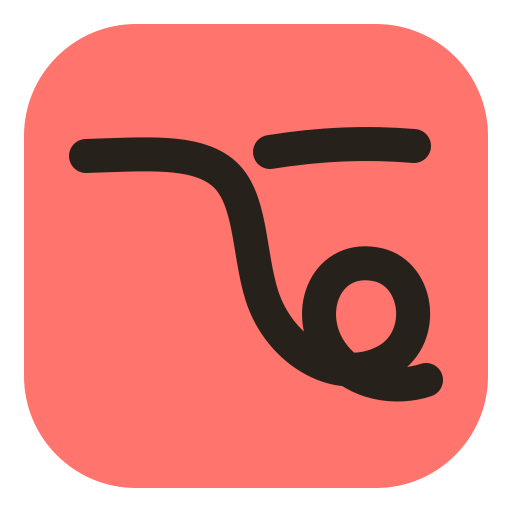
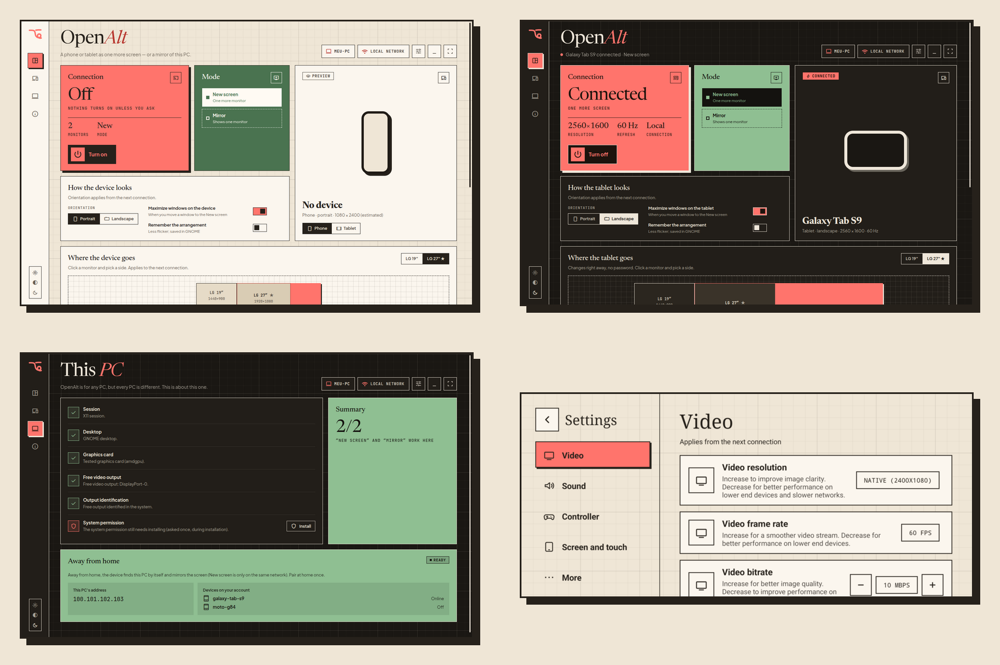

<p align="center"></p>

<h1 align="center">OpenAlt</h1>

<p align="center"><b>Empowering anyone to stream anywhere.</b></p>

<p align="center">Turn your Android phone or tablet into a second monitor, a mirror of your PC, or a game screen. At home or away. Scan one QR code and you're in.</p>

<p align="center"></p>

OpenAlt is **free and open source** (GPL-3.0). No account, no subscription, no servers of ours: your PC streams straight to your device.

> [!WARNING]
> **Early preview.** OpenAlt works every day on the developer's own PC, but it has been tested on very few machines so far. Read [Known issues](#known-issues) before you try it, and expect rough edges.

<p align="center"></p>

## Why

Most people have a phone or tablet lying around that would make a perfectly good extra screen. The tools that already do this either cost money, lock you into one brand, need a cable, or ask you to type IP addresses and PINs.

OpenAlt wants the opposite:

- **For anyone.** Any phone or tablet, standing or lying down, beside any of your monitors, on any side. The app adapts to the PC it runs on and tells you plainly what works there and why.
- **As few clicks as possible.** Install, press *Turn on*, scan the QR code. That's the whole setup.
- **Home and away.** On your home Wi-Fi the device becomes a real new screen. Away from home (4G, a café, a trip) it mirrors your PC through your own Tailscale account.
- **Built on giants.** It doesn't reinvent streaming: it sets up [Sunshine](https://github.com/LizardByte/Sunshine) on the PC for you, and the Android app is a fork of [Moonlight](https://github.com/moonlight-stream/moonlight-android). OpenAlt is the part that makes them feel like one simple product.
- **Private by design.** Nothing leaves your network except what you choose to send through your own Tailscale. No analytics, no telemetry.

## What it does

**On the PC** (Linux, GNOME on X11 for now)

- **New screen:** creates a real extra monitor at your device's own resolution, placed right, left, above or below any of your monitors, aligned to the start, center or end.
- **Mirror:** shows any one of your monitors on the device.
- **Pair by QR code:** a one-time code that expires quickly; the device is confirmed automatically.
- **Away from home:** detects Tailscale, signs you in with one click (your password stays with your system and your browser), and shows which of your devices are online and whether the connection is direct or relayed.
- **Preferences per device:** where each phone or tablet goes, portrait or landscape, maximize windows on it.
- **Checks your PC first** ("This PC"): session, desktop, graphics card, free video output and permissions, before it tries anything.
- **Opens in fullscreen** like a console launcher, with an opening animation and music, light and dark themes, a guided tour, and runs in the background from the system tray.

**On Android** (phone or tablet, Android 5+)

- A **console-style start screen**: big cards for your PCs, controller support (Xbox, PlayStation or Nintendo button names), interface sounds, and the same opening as the PC.
- **Scan to pair**, then one tap (or the A button) to connect.
- **Console-style settings**: video, sound, controller, touch, plus every Moonlight option.
- **Button mapping** per controller.
- Finds your PC at home and through Tailscale, using the addresses from the QR code.

Languages: **English, Portuguese and Spanish** in both apps (the system's language by default).

## How it works

```
        PC (Linux)                                   Phone / tablet (Android)
 ┌───────────────────────────┐                      ┌──────────────────────────┐
 │ OpenAlt app (Electron)    │   1. QR code         │ OpenAlt app              │
 │  · shows the QR code      │ ───────────────────► │ (Moonlight fork)         │
 │  · sets up Sunshine       │                      │  · pairs from the QR     │
 │  · places the new screen  │   2. video, audio,   │  · plays the stream      │
 │                           │      input           │  · sends touch, keys,    │
 │ Sunshine (separate        │ ◄──────────────────► │    controller            │
 │ process, unmodified)      │   home Wi-Fi, or     │                          │
 │  · runs OpenAlt's bridge  │   Tailscale away     │                          │
 │    when a device connects │                      │                          │
 └───────────────────────────┘                      └──────────────────────────┘
```

When a device connects, Sunshine calls OpenAlt's bridge with the device's resolution. In **New screen** mode the bridge turns a free video output of your graphics card into a virtual monitor (no dummy plug needed on AMD), asks GNOME to place it where you chose without moving your other monitors, and Sunshine captures only that screen. When the device leaves, everything is put back. Over **Tailscale** the bridge always mirrors: a new screen only makes sense where you sit next to the PC.

The design decisions are written down as ADRs in [`docs/adr/`](docs/adr/) (in Portuguese).

## Known issues

This is the honest list. If you hit something not listed here, please open an issue.

- **The mouse can stay stuck on the second monitor.** After a New screen session, the pointer may keep going to (or staying on) another monitor.
- **Duplicated cursor at the screen edge** in some cases. This comes from Sunshine's X11 capture.
- **Video in Chromium-based browsers** (Chrome, Brave) can freeze on the virtual screen. Not yet investigated in a controlled test.
- **No wallpaper on the new screen right after connecting.** OpenAlt no longer restarts GNOME when a device connects (it shuffled monitors and windows); if the new screen stays without wallpaper, restart GNOME yourself with Alt+F2, `r`, Enter (your programs stay open). The app shows this tip while connected. GNOME is still restarted once after the device disconnects, so the wallpaper comes back; the first time, before OpenAlt's small GNOME extension is loaded, that restart briefly shows the Alt+F2 box.
- **AMD graphics cards stream in H.264 only.** HEVC through VAAPI leaves green bars when mirroring ([Sunshine#4314](https://github.com/LizardByte/Sunshine/issues/4314)), so OpenAlt turns it off on AMD.
- **Away from home is mirror only**, by design. If one device is streaming through Tailscale while another connects on your home Wi-Fi, the second one may be treated as "away" and mirror too.
- **Without the system helper installed**, disconnecting leaves the device's video output reserved (off your desktop) until you press *Turn off* or connect again, and *Turn off* asks for your password. The installer (next milestone) fixes this.
- **Button mapping** may not apply on controllers that Moonlight already remaps internally. Not yet tested with many controllers.

**What has and hasn't been tested**

| | Status |
|---|---|
| Zorin OS 18 (GNOME 46, X11), AMD RX 6600, two monitors | tested |
| Galaxy S20 FE (phone) and Galaxy Tab S6 Lite (tablet) | tested |
| Away from home over 4G with Tailscale | tested |
| Xbox and PlayStation controllers through the phone | tested |
| Other GNOME X11 distros (Ubuntu on X11, Fedora on X11, Debian, Pop!_OS 22.04) | expected to work, untested |
| Intel graphics | untested |
| NVIDIA proprietary driver | **likely not working yet** (it usually refuses modes on outputs with nothing plugged in) |
| Hybrid laptops, USB-C docks with several monitors | untested |
| KDE, XFCE, Cinnamon | Mirror should work; New screen does not yet |
| **Wayland** (the default on Ubuntu and Fedora) | **not supported yet** |
| Windows, macOS, iOS | not supported |

The full list, with what each guess is based on, is in [`docs/compatibilidade.md`](docs/compatibilidade.md). On any PC, `npx openalt-core display check` (from the project folder) reports what will work there, and only reads.

## Roadmap

| | Milestone | Status |
|---|---|---|
| M0 | Spikes: virtual monitor, Sunshine, Moonlight on a real device | ✅ done |
| M1 | PC app for Linux: virtual monitor, Sunshine setup, the interface | ✅ done |
| M2 | Android app (Moonlight fork) with QR pairing | ✅ done |
| M3 | Away from home with Tailscale; picture and sound fixes | ✅ done |
| M4 | Polish and installer: AppImage, .deb, signed APK, install guide | 🚧 in progress |
| M5 | Windows | planned |
| M6 | Wayland | planned |
| M7 | Research: Tailscale built into the app (tsnet), WebRTC | research |

Where we want to get: a phone or tablet you already own becomes a second screen, a mirror or a game screen **in under a minute, on any PC**, with nothing to configure and nothing to pay.

## Download

From the [latest release](https://github.com/berelels/openalt/releases/latest):

| | File |
|---|---|
| PC, any Linux (GNOME on X11) | [`openalt-0.1.1-x86_64.AppImage`](https://github.com/berelels/openalt/releases/download/v0.1.1/openalt-0.1.1-x86_64.AppImage): make it executable and run it |
| PC, Ubuntu / Debian / Zorin / Pop!_OS | [`openalt-0.1.1-amd64.deb`](https://github.com/berelels/openalt/releases/download/v0.1.1/openalt-0.1.1-amd64.deb): `sudo apt install ./openalt-0.1.1-amd64.deb` |
| Android 5+ | [`openalt-0.1.1.apk`](https://github.com/berelels/openalt/releases/download/v0.1.1/openalt-0.1.1.apk) |

You also need [Sunshine](https://github.com/LizardByte/Sunshine) on the PC (on first run the app can install the Flatpak for you). The `.deb` installs OpenAlt's system helper too; with the AppImage, press **Install** next to *System permission* in **This PC** once (it asks for your password). Checksums are in `SHA256SUMS.txt` on the release page.

## Run from source

**PC requirements:** Linux with GNOME on **X11**, [Node.js](https://nodejs.org) 24 or newer, and [Sunshine](https://github.com/LizardByte/Sunshine) (Flatpak or .deb; on first run the app can install the Flatpak for you). For away from home, [Tailscale](https://tailscale.com/download) on the PC and on the device.

```bash
git clone https://github.com/berelels/openalt
cd openalt
npm install
node scripts/dev.mjs
```

`scripts/dev.mjs` builds everything, keeps all its data in `.dev/` inside the project, and opens the app. In this mode **New screen** uses the helper from the project folder, so the system asks for your password when the screen is added or removed.

To let New screen work without a password prompt, install the system helper and its polkit rule once (the installer will do this for you later):

```bash
sudo install -Dm755 core/helper/openalt-helper /usr/libexec/openalt/openalt-helper
sudo install -Dm644 core/helper/dev.cattastudios.openalt.policy /usr/share/polkit-1/actions/dev.cattastudios.openalt.policy
```

**Android:** the APK is built by GitHub Actions on every push (artifact `openalt-apk-debug`). To build it yourself you need the Android SDK and NDK:

```bash
cd android
./gradlew assembleNonRootDebug
```

**Tests:**

```bash
npm test
npm run typecheck
```

The unit tests use a fake command runner and never touch your screens.

## How the code is organized

| Part | Where |
|---|---|
| Core: virtual monitor, layout, Sunshine setup, pairing, Tailscale, the CLI and Sunshine bridge (TypeScript, runs on Node directly) | [`core/`](core/) |
| Layout math (any number of monitors, any side, any alignment) | [`core/src/layout.ts`](core/src/layout.ts) |
| Linux / X11 / GNOME specifics | [`core/src/linux-x11/`](core/src/linux-x11/) |
| Root helper and polkit rule (the only part that runs as root) | [`core/helper/`](core/helper/) |
| GNOME extension that restarts GNOME without the Alt+F2 box | [`core/gnome-shell/`](core/gnome-shell/) |
| PC app (Electron): main process, interface, opening, tour | [`desktop/`](desktop/) |
| Android app (fork of Moonlight Android 12.2); OpenAlt's own code | [`android/app/src/main/java/dev/cattastudios/openalt/`](android/app/src/main/java/dev/cattastudios/openalt/) |
| Website | [`site/`](site/) |
| Decisions (ADRs), test results, compatibility | [`docs/`](docs/) |
| README images and the scripts that make them from the real app | [`art/`](art/) |

Changes to Moonlight's own files are kept small and marked `OpenAlt:`, so upstream updates can still be merged.

## Security

- The PC app opens **no network port** of its own; the interface talks to the main process over IPC only.
- Pairing codes are random, single-use and expire quickly. Credentials are stored with `0600` permissions and never logged or shown.
- Every external command runs with an argument list, never through a shell.
- The root helper does one thing: turn one named video output on (with OpenAlt's monitor description) or give it back to automatic. Everything else runs as you.

More in [ADR-0006](docs/adr/0006-modelo-de-seguranca.md).

## Credits and license

Made by [Gabriel Dias](https://github.com/berelels) at **Catta Studios**.

<sub>An honest note: the idea, the design, the decisions and the testing on real devices are mine; the code was written by Claude, Anthropic's AI, under my direction.</sub>

OpenAlt stands on the shoulders of:

- [Sunshine](https://github.com/LizardByte/Sunshine) by LizardByte (GPL-3.0), the streaming host.
- [Moonlight Android](https://github.com/moonlight-stream/moonlight-android) and [moonlight-common-c](https://github.com/moonlight-stream/moonlight-common-c) (GPL-3.0), the base of the Android app.
- [Tailscale](https://tailscale.com) for away from home (installed separately, with your own account).

OpenAlt is licensed under the **GNU GPL v3.0 or later** (see [LICENSE](LICENSE)). The Newsreader, Plus Jakarta Sans and JetBrains Mono fonts are under the SIL Open Font License. The website uses [GSAP](https://gsap.com) under its own [Standard No-Charge License](https://gsap.com/standard-license) (not GPL).
